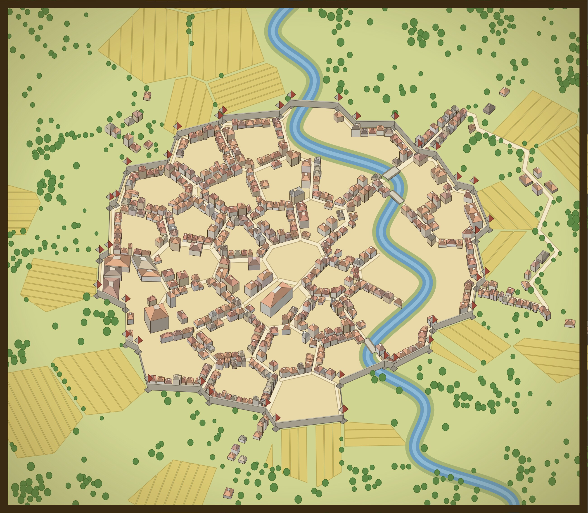
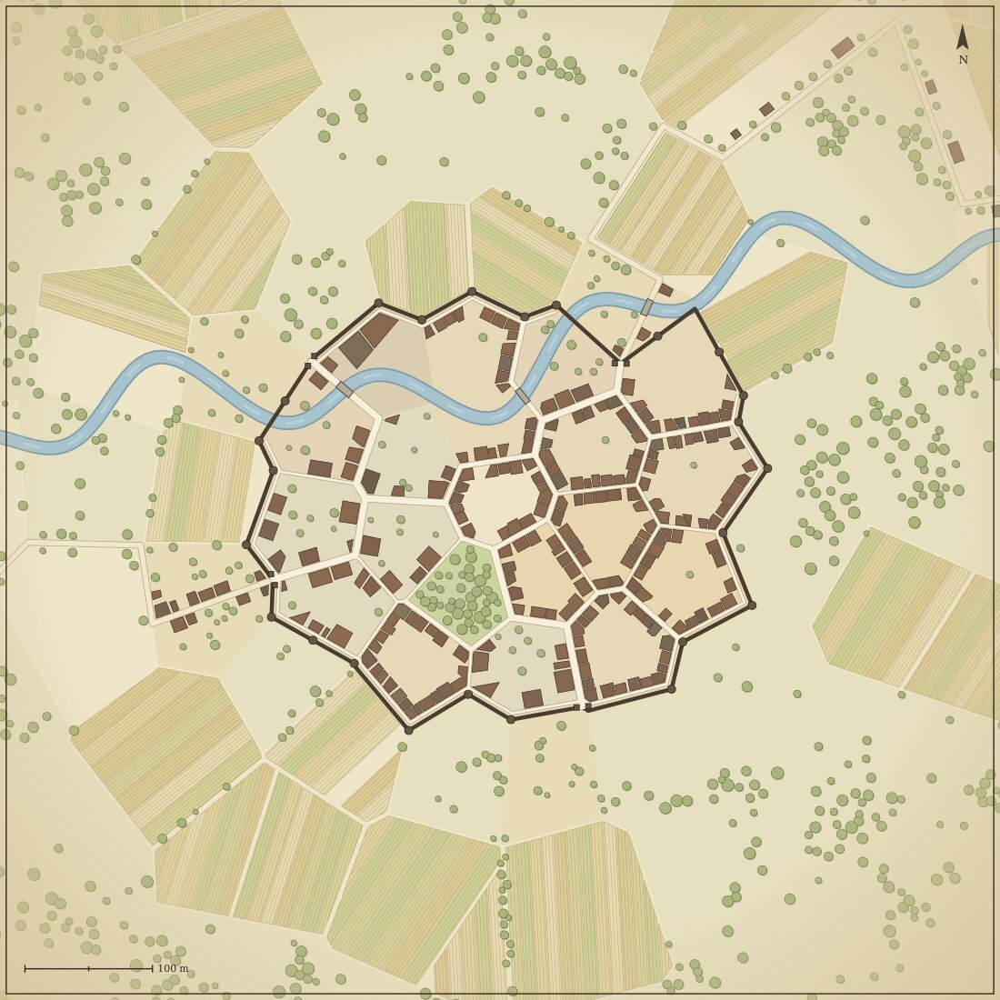
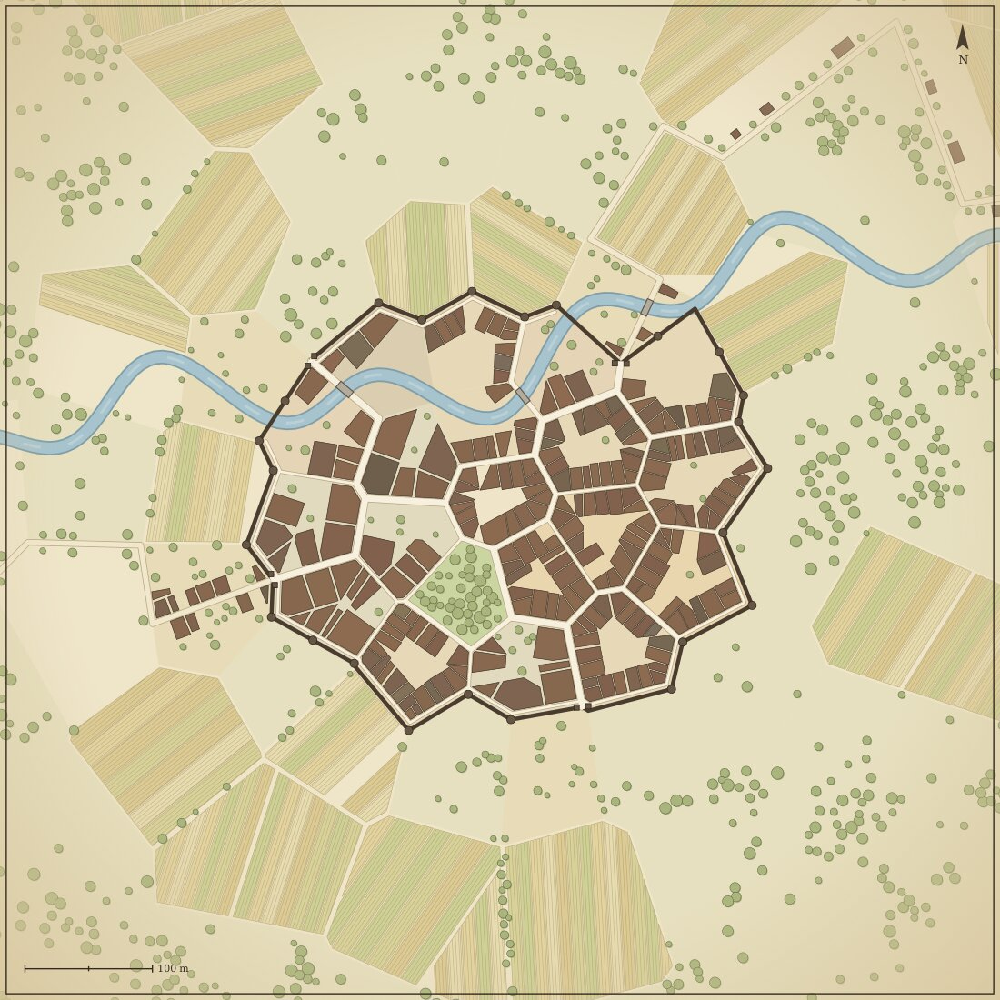
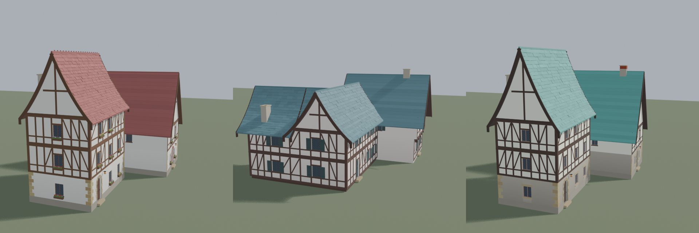
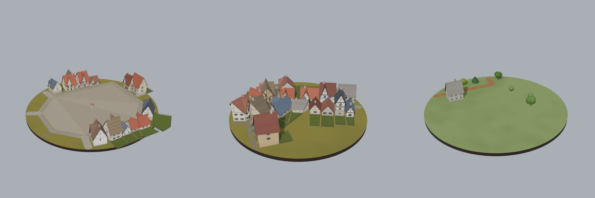
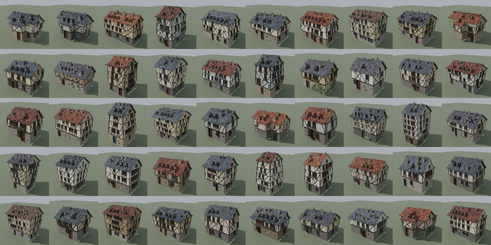

# Town Medieval Generator

Procedural medieval **town and village generator** written in Rust. It lays out a
whole town (districts, walls, streets, house lots, fields, trees, river, bridges),
builds the houses in 3D, and exports everything as a `.glb` file plus plain JSON.

## Where this comes from

I tried to build my own medieval town generator. I borrowed ideas and assets from
existing open-source work, then mixed in my own pieces so I can use the result in
my **Unreal Engine** game.

Credits:

- **IRCSS / Shahriar Shahrabi**, [Blender Geometry Node French Houses](https://github.com/IRCSS/Blender-Geometry-Node-French-Houses)
  (MIT). The 50 village house models in `assets/houses/` and the window, door and
  landmark parts in `assets/parts/` are derived from this project. Their licence
  and copyright notice are kept next to those files.
- **watabou** (Medieval Fantasy City Generator and Dwellings). Inspiration for the
  town layout (district cells, walls) and the house plans. No code from it is used.

Everything else (town layout, house building, roofs, yards, mesh and glTF export) is my own code.

## Two generators

This repo holds two versions side by side. Both are complete and work on their own.

| | [`generator-1`](generator-1) | [`generator-2`](generator-2) |
|---|---|---|
| What it is | The **newer** version. Continues generator 2. | The **older** version. The first working build. |
| Look | **Storybook** style: cream walls, dark timber, curved roofs with flared eaves, bargeboards, a cross gable on the front of wide houses, uneven roof tiles | **Classic** plain look: simple straight roofs |
| Houses | At most 3 floors. House size is capped (about 10 x 13 m, mansions 14 x 18 m) | Free size, no cap |
| Yards | The rest of a big lot becomes a **fenced backyard** with a gate | No yards |
| Detail | Up to 4,000 triangles per house | Up to 2,000 triangles per house |
| Palette | Extra `storybook` colour set for the whole town | Regional colour sets only |
| Tests | All pass | 1 known failing test (`custom_parts_leave_bare_holes` in `mde_mesh`) |

**Why two?** Generator 2 was the first complete version. I then kept going in a new
copy and added the storybook look, yards and size rules. I kept the old one because
its simpler, lighter houses may suit some scenes, and so I can compare the two.

**Which one should I use?** Start with **generator 1**. Use generator 2 only if you
want the plain classic look and lighter meshes.

## Pictures

**A walled town with a river, roads and bridges** (generator 1, seed 3, 38 districts, 536 buildings),
drawn as an angled 2.5D map from the town data:



**Map of the same town, made by each generator** (seed 42, 20 patches, walls, river, stone bridges):

| Generator 1 | Generator 2 |
|---|---|
|  |  |

**Generator 1 houses: the storybook look.** Cream walls, dark timber, curved roofs with flared eaves,
a cross gable on the front, and teal or terracotta roofs:



**Generator 1 villages: fenced backyards with gates.** Three small test villages (a plaza, a street, a lone farm):



**The 50 ready-made village houses** (both generators, from IRCSS's French Houses):



## How to use

You need [Rust](https://rustup.rs) (a recent stable version). Run the commands
inside `generator-1` or `generator-2`. The commands are the same.

### 1. Make a town (3D file, map and data)

```sh
cd generator-1
cargo run -p mde_mesh --example town_glb --release
```

This writes three files to `out/town/`:

- `town_1.glb`: the 3D town. Open it in Blender or any glTF viewer, or import it into your game engine.
- `town_1.svg`: a flat map of the town.
- `town_1.json`: the town data (streets, lots, buildings...).

Change the town with three arguments: `seed patches flags`.

```sh
cargo run -p mde_mesh --example town_glb --release -- 42 20 walls,river,stone,storybook
```

- **seed**: any number. The same seed always makes the same town.
- **patches**: town size. About 6 is a hamlet, 15 a village, 30 a town, 60 or more a city.
- **flags**: a comma list. `walls`, `citadel` (castle), `plaza`, `temple`, `river`, `stone` (stone bridges instead of wood).
  Generator 1 also has `storybook` (the storybook colours).

### 2. Just the flat map

```sh
cargo run -p mde_town --example town_svg --release
```

Writes sample maps to `out/mde_town/`.

### 3. Sample houses and bridges

```sh
cargo run -p mde_mesh --example mesh_preview --release
```

Writes example `.glb` files (houses, roofs, windows, doors, bridges) to `out/mde_mesh/`.

### 4. Use it from your own Rust code

```rust
use mde_core::TownParams;

let town = mde_town::generate(&TownParams { seed: 42, patches: 20, ..Default::default() });
let models = mde_mesh::build_town(&town, &Default::default());
let glb: Vec<u8> = mde_mesh::gltf::write_glb(&models);
```

The town is plain data (it saves as JSON), so you can also read the JSON in
another program or engine and build the town there.

### Tests

```sh
cargo test -p mde_core -p mde_town -p mde_mesh -p mde_dwelling
```

## What is inside

| Folder | What it does |
|---|---|
| `crates/mde_core` | Shared data types (town, building, house), random numbers, polygon helpers |
| `crates/mde_town` | The town layout generator |
| `crates/mde_dwelling` | The house floor plan generator (rooms, doors, windows, stairs) |
| `crates/mde_mesh` | Turns towns and houses into 3D meshes and writes `.glb` |
| `crates/mde_nav` | Unfinished walking and navigation code |
| `crates/mde_app`, `crates/mde_cli` | Empty placeholders. Not built yet. |
| `assets/houses` | 50 ready-made French-style village houses (`.glb`) |
| `assets/parts` | Extra windows, doors and landmarks. Drop your own `.glb` files here. |
| `tools/blender` | Blender scripts that made the assets (need Blender 5 as a Python module) |

Coordinates: plan space is metres, x east, y north. 3D files use Y up, in metres.
The random generator is deterministic, so a seed gives the same town on every computer.

## Known limits

- Work in progress. The viewer app, command line tool and walking NPCs are not finished.
- Generator 2 has one failing test (see the table above).

## Licence

[MIT](LICENSE), copyright silveray. The house and part models in `assets/` are
derived from IRCSS's MIT-licensed project, and keep its own `LICENSE` file.
