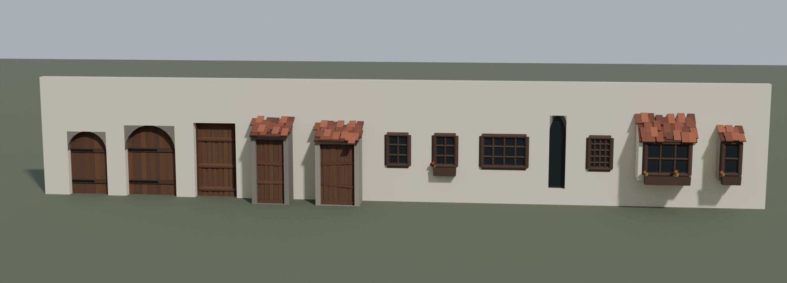
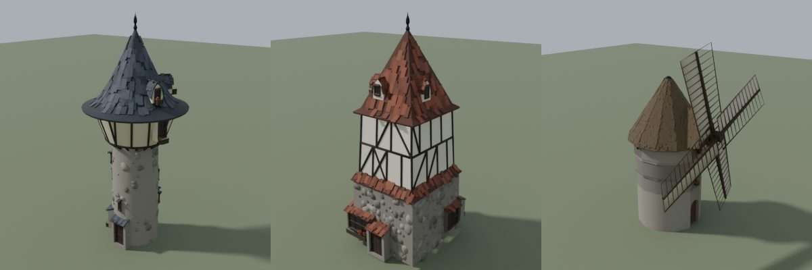

# Part catalogue (windows, doors, landmarks)

Extra models that users can put on buildings: window and door designs that replace
the procedural `WindowKind` / `DoorKind` (via `Appearance::custom_window` /
`Appearance::custom_door`, which hold a part `id` such as `"window/oriel_01"`),
plus a few landmark buildings. **Anyone can extend it by dropping GLBs in here.**




```
assets/parts/
  manifest.json        catalogue (schema 1)
  window/<name>.glb    id "window/<name>"
  door/<name>.glb      id "door/<name>"
  landmark/<name>.glb  id "landmark/<name>"
```

## Conventions

All parts: glTF 2.0 binary, **Y up, metres**, real-world size, materials named after
`mde_core::MaterialSlot` (see below).

**Windows and doors**

* The **wall plane is glTF XY** (z = 0) and the part **faces +Z** (outward, towards
  the street). Blender's glTF exporter maps Blender −Y to glTF +Z, so in Blender
  the part faces −Y with the wall surface at y = 0 (X right, Z up).
* The **centre of the opening is at the origin**. The opening is the clear opening:
  the glass of a window, the leaf of a door. `width` × `height` in the manifest is
  that opening's size; `depth` is the part's total extent along z.
* `mount: "flush"` — cut a `width` × `height` hole in the wall, centred where the
  origin goes, and the part fills it. Frames may stick out (+z) and reveals go back
  into the wall (−z). Anything inside the rectangle that is not glass or door (the
  stone spandrels of an arch, a reveal) belongs to the part, so a rectangular hole is
  always enough.
* `mount: "surface"` — oriels and porches stand on the wall: their back is at
  z = 0 (2 cm into the wall), everything else is in front. A viewer still cuts the
  `width` × `height` hole behind a porch door so NPCs can walk through.
* Placement: a door's origin goes `height / 2` above the floor; a window's origin is
  the window centre (sill + `height / 2`).

**Landmarks** are placed like the houses: origin at the centre of the footprint on
the ground (y = 0); they have no preferred front.

## Materials and recolouring

Use only canonical slot names as material names: `Plaster`, `Timber`, `Stone`,
`RoofTile`, `Slate`, `Thatch`, `Planks`, `Door`, `WindowFrame`, `Glass`, `Iron`,
`Foliage` (any `MaterialSlot` name is valid). The viewer recolours a part by slot —
`WindowFrame` takes the building's window colour, `Door` its door colour, `RoofTile`
canopies its roof colour, `Plaster` / `Stone` its wall colours — by replacing the
base colour, so keep textures out of recolourable slots. Optional `COLOR_0`
multiplies the base colour (glTF rule); use it for subtle variation, or for real
colours on a white `Foliage` material. Parts made here store `POSITION`, `NORMAL`
and `COLOR_0` only.

## Adding your own part

1. Model it following the conventions above (in Blender: facing −Y, wall surface at
   y = 0, opening centred on the origin, metres, transforms applied).
2. Name its materials with canonical slot names.
3. Export a GLB: *File → Export → glTF 2.0*, format *glTF Binary*, *+Y Up* on, *Apply
   Modifiers* on, *Selected Objects* only; no cameras or lights.
4. Drop it into the matching folder, e.g. `assets/parts/window/round_01.glb`.
5. Either add an entry to `manifest.json` (preferred: it carries the opening size and
   a label), or rely on **auto-scan**: viewers scan `window/`, `door/` and
   `landmark/` for `*.glb` files that are not in the manifest and register them as
   `id = "<folder>/<file stem>"` with `width` / `height` / `depth` taken from the
   model's bounding box (so for an unlisted window the whole frame counts as the
   opening) and `mount: "flush"`. Manifest entries always win over scanned values.
6. Check it: `python3 tools/blender/validate_assets.py` (lists unlisted GLBs with
   their bounds) and, with Blender's `bpy`, render it into a test wall with
   `python -I tools/blender/preview_parts_wall.py -- --out out/parts_wall.png`.

Manifest entry (required fields first; the rest are optional):

```json
{ "id": "window/round_01", "category": "window", "file": "window/round_01.glb",
  "width": 0.6, "height": 0.6, "depth": 0.15, "triangles": 220,
  "source": "your name / licence",
  "label": "Round oculus window", "mount": "flush",
  "materials": ["Stone", "WindowFrame", "Glass"],
  "bounds_min": [-0.4, -0.4, -0.1], "bounds_max": [0.4, 0.4, 0.05] }
```

`id` must be unique and start with its `category` (`window`, `door` or
`landmark`); `file` is relative to this folder. Keep the `source` field honest about
the licence of what you add. `export_parts.py` rewrites only the entries it owns
and keeps hand-added ones.

## Included parts

| id | mount | opening w × h × depth (m) | triangles | |
|---|---|---|---|---|
| `window/casement_01` | flush | 0.65 × 0.94 × 0.16 | 78 | Six-light timber casement |
| `window/casement_wide_01` | flush | 1.33 × 0.94 × 0.16 | 96 | Wide multi-light window (shop / hall front) |
| `window/lattice_01` | flush | 0.65 × 0.94 × 0.16 | 116 | Small-paned (lattice) timber window |
| `window/casement_flowers_01` | flush | 0.65 × 0.94 × 0.35 | 142 | Casement with a flower box |
| `window/lancet_01` | flush | 0.50 × 2.24 × 0.20 | 137 | Gothic lancet (pointed arch) |
| `window/oriel_01` | surface | 1.26 × 0.94 × 1.07 | 566 | Wide oriel (bay) window, lean-to roof, flower box |
| `window/oriel_02` | surface | 0.49 × 0.94 × 0.87 | 240 | Narrow stone oriel |
| `door/plank_01` | flush | 1.32 × 2.35 × 0.29 | 122 | Ledged plank door (the houses' entrance door, incl. frame) |
| `door/arched_01` | flush | 1.25 × 2.02 × 0.22 | 112 | Round-arched plank door with iron straps, stone reveal |
| `door/arched_wide_01` | flush | 1.61 × 2.24 × 0.25 | 118 | Wide arched door (barn, tavern, workshop) |
| `door/porch_01` | surface | 1.01 × 1.99 × 1.04 | 386 | Plank door in a stone porch with a tiled canopy |
| `door/porch_02` | surface | 1.14 × 1.88 × 1.19 | 480 | Wider porch door |
| `landmark/tower_round_01` | — | 5.9 × 13.2 × 5.9 | 14 450 | Round watchtower, timber-framed top storey |
| `landmark/tower_square_01` | — | 5.7 × 12.2 × 5.1 | 23 257 | Square tower house |
| `landmark/windmill_01` | — | 14.2 × 15.8 × 8.7 | 24 911 | Stone tower windmill with sails |

(For landmarks the size columns are the bounding box.)

## Provenance and licence

The included parts are generated from IRCSS's MIT-licensed Geometry-Nodes project
<https://github.com/IRCSS/Blender-Geometry-Node-French-Houses> (commit `b49b3c1`)
by `tools/blender/export_parts.py`: window and door node groups (`Generate Windows`,
`GenerateAlcoveWindows`, `GenerateWindowsFromEdges`, `GenerateDoorsWithAlcove`,
`CurvedDoorFromEdges`, the `GenerateHouse` entrance) and the `Generate Tower`,
`Generate Square Tower` and `WindMill` groups, driven with simple point / edge /
quad inputs. The arched doors' planks, ledges and iron straps were added by the
exporter (upstream draws them with a texture that does not survive glTF). See
`LICENSE` in this folder. Parts that users add keep their own licences (state them
in `source`).
